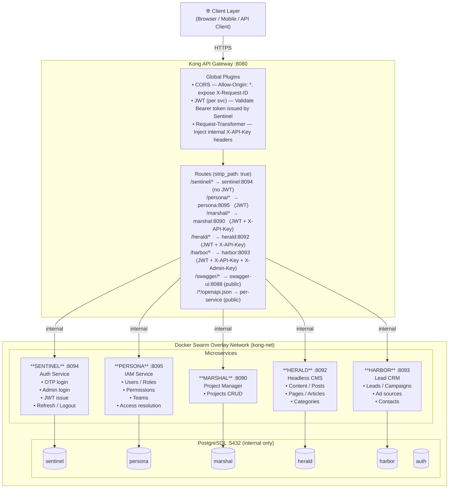
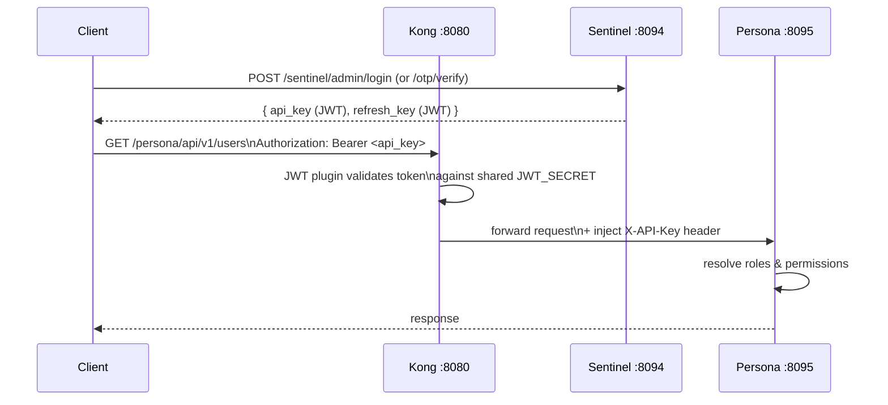
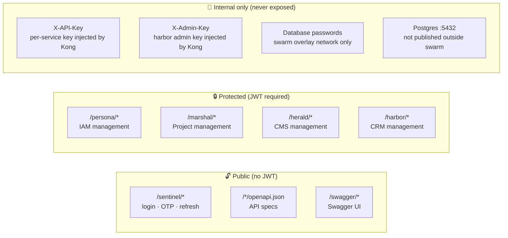

# TafakoriTech — Microservices Architecture

## Overview

## Service Catalogue

| Service      | Port | Responsibility                                    | DB          |
|--------------|------|---------------------------------------------------|-------------|
| **Sentinel** | 8094 | Authentication — OTP & admin login, JWT issuance  | `sentinel`  |
| **Persona**  | 8095 | IAM — Users, Roles, Permissions, Teams, Access    | `persona`   |
| **Marshal**  | 8090 | Project management — Projects CRUD                | `marshal`   |
| **Herald**   | 8092 | Headless CMS — Content, Posts, Pages, Articles   | `herald`    |
| **Harbor**   | 8093 | Lead CRM — Leads, Campaigns, Ad platforms         | `harbor`    |
| **Kong**     | 8080 | API Gateway — routing, JWT validation, CORS       | —           |
| **Swagger**  | 8088 | API documentation UI                              | —           |
| **Postgres** | 5432 | Database (internal only)                          | —           |

## Authentication & Authorization Flow

## Security Model

## Port Map (external)

| Port   | Service            |
|--------|--------------------|
| `8080` | Kong proxy (API)   |
| `8001` | Kong admin         |
| `8088` | Swagger UI         |

All other service ports are internal to the Docker Swarm overlay network only.

## Tech Stack

| Layer         | Technology                         |
|---------------|------------------------------------|
| Language      | Go 1.22                            |
| Framework     | Gin (HTTP)                         |
| Database      | PostgreSQL 16                      |
| Driver        | pgx/v5                             |
| Auth tokens   | JWT HS256 (golang-jwt/jwt)         |
| Gateway       | Kong 3.7 (DB-less declarative)     |
| Orchestration | Docker Swarm                       |
| Logging       | zap (Persona), stdlib (others)     |
| Docs          | OpenAPI 2.0 (Swagger UI)           |
