# Adding a New Service to TafakoriTech

Flow for integrating a new microservice regardless of language (Go/Gin, NestJS, PHP).

```mermaid
flowchart TD
    Start(["➕ New Service: <name>"])

    Start --> LANG{"Language /\nFramework?"}

    LANG -->|Go / Gin| GO_DIR
    LANG -->|NestJS| NEST_DIR
    LANG -->|PHP| PHP_DIR

    subgraph SERVICE["1 — Service Directory"]
        GO_DIR["/<name>/\n  cmd/<name>/main.go\n  internal/...\n  go.mod\n  Dockerfile\n  Makefile\n  migrations/\n  .env / .env.example"]

        NEST_DIR["/<name>/\n  src/\n    main.ts\n    app.module.ts\n  package.json\n  tsconfig.json\n  nest-cli.json\n  Dockerfile\n  Makefile\n  migrations/\n  .env / .env.example"]

        PHP_DIR["/<name>/\n  src/\n  public/index.php\n  composer.json\n  Dockerfile  (php:8.x-fpm + nginx/caddy)\n  Makefile\n  migrations/\n  .env / .env.example"]
    end

    GO_DIR --> GOWORK
    NEST_DIR --> SKIP_GOWORK
    PHP_DIR --> SKIP_GOWORK

    subgraph WORKSPACE["2 — Go Workspace  (Go only)"]
        GOWORK["go.work\n→ add  ./‹name›  to  use (...)"]
        SKIP_GOWORK["— skip —\ngo.work is Go-only;\nno change needed"]
    end

    GOWORK --> C
    SKIP_GOWORK --> C

    subgraph POSTGRES["3 — Database"]
        C["infra/postgres/init/*.sql\n→ add  CREATE DATABASE <name>"]
        C --> C2["<name>/migrations/001_init.sql\n→ write schema\n\nGo   → raw SQL, run via refresh.sh\nNest → TypeORM migrations  (npm run migration:run)\nPHP  → Doctrine migrations  (php bin/console doctrine:migrations:migrate)"]
    end

    C2 --> D

    subgraph SECRETS["4 — Secrets & Env Vars"]
        D["infra/.env  +  infra/.env.example\n→ add  <NAME>_IMAGE\n       <NAME>_API_KEY\n       <NAME>_DATABASE_URL"]
        D --> D2["docker secret create <name>_api_key ...\n(Swarm production only)"]
    end

    D2 --> E

    subgraph COMPOSE["5 — docker-compose.yml  (dev)"]
        E["Add service block:\n  image: \${<NAME>_IMAGE}\n  environment:\n    PORT / DATABASE_URL / API_KEY\n  ports: 99XX:99XX\n  networks: kong-net\n  depends_on: postgres\n\nNestJS extra:\n  NODE_ENV: development\nPHP extra:\n  mount php.ini / nginx.conf if needed"]
        E --> E2["swagger-ui → URLS env\n→ append JSON entry for <name>"]
    end

    E2 --> F

    subgraph STACK["6 — docker-stack.yml  (prod / Swarm)"]
        F["Add service block:\n  image: \${<NAME>_IMAGE}\n  environment (PORT, DATABASE_HOST/NAME)\n  secrets: postgres_password, jwt_secret, <name>_api_key\n  networks: kong-net\n  deploy: replicas, restart_policy, update_config"]
        F --> F2["secrets: section\n→ add  <name>_api_key: external: true"]
        F2 --> F3["swagger-ui → URLS env\n→ append JSON entry for <name>"]
    end

    F3 --> G

    subgraph KONG["7 — Kong Gateway  (infra/kong/kong.yml)"]
        G["Add docs service:\n  name: <name>-docs\n  url: http://<name>:<PORT>/openapi.json\n  route: /<name>/openapi.json  [GET, public]"]
        G --> G2["Add main service:\n  name: <name>\n  url: http://<name>:<PORT>\n  route: /<name>  strip_path: true\n  plugins:\n    jwt             (if auth required)\n    request-transformer → X-API-Key header"]
    end

    G2 --> H

    subgraph REFRESH["8 — infra/refresh.sh"]
        H{"Go service?"}

        H -->|yes| H_GO["Add to ALL Go maps:\n  SVC_IMAGE  [<name>]='\${<NAME>_IMAGE}'\n  SVC_DIR    [<name>]='<name>'\n  SVC_MAIN   [<name>]='./cmd/<name>'\n  SVC_BIN    [<name>]='<name>/<name>'\n  SVC_DOCKERFILE [<name>]='<name>/Dockerfile'\n  ALL_SERVICES append <name>\n\n→ refresh.sh will compile binary\n  then docker build as usual"]

        H -->|NestJS / PHP| H_OTHER["Add lightweight block:\n\n  # Step 2b — build non-Go images\n  docker build \\\n    --file <name>/Dockerfile \\\n    --tag \${<NAME>_IMAGE} \\\n    .\n\n  ALL_SERVICES still controls\n  Step 4-6 (deploy + force-update)\n  so append <name> there too.\n\n  SVC_IMAGE / SVC_DOCKERFILE\n  still needed for force-update loop;\n  SVC_MAIN / SVC_BIN → leave empty / skip"]
    end

    H_GO --> I
    H_OTHER --> I

    subgraph DEPLOY["9 — infra/deploy.sh  (migrations)"]
        I{"Migration tool?"}
        I -->|Go raw SQL| I_GO["docker exec postgres psql -d <name>\n  < ../<name>/migrations/001_init.sql"]
        I -->|NestJS TypeORM| I_NEST["docker exec TafakoriTech_<name> \\\n  npm run migration:run"]
        I -->|PHP Doctrine| I_PHP["docker exec TafakoriTech_<name> \\\n  php bin/console doctrine:migrations:migrate --no-interaction"]
    end

    I_GO --> J
    I_NEST --> J
    I_PHP --> J

    subgraph DOCS["10 — ARCHITECTURE.md"]
        J["Service Catalogue table → add row\n  (name, port, responsibility, DB, tech stack)\nMermaid graph → add node + DB node\nPort Map → add internal port\nSecurity Model → Public / Protected block\nTech Stack table → add language/framework row"]
    end

    J --> K

    subgraph VERIFY["11 — Verify"]
        K["./infra/refresh.sh <name>"]
        K --> K2{"Healthy?"}
        K2 -->|no| K3["docker service logs TafakoriTech_<name>\n→ fix & rerun refresh.sh"]
        K3 --> K
        K2 -->|yes| K4["curl :9506/<name>/openapi.json\n→ appears in Swagger UI\ncurl :9506/<name>/health  (if endpoint exists)"]
    end

    K4 --> Done(["✅ Service live & integrated"])
```

---

## What differs by language

| Step | Go / Gin | NestJS | PHP |
|------|----------|--------|-----|
| **Directory** | `go.mod`, `cmd/`, `internal/` | `package.json`, `src/`, `tsconfig.json` | `composer.json`, `src/`, `public/` |
| **go.work** | Add `./‹name›` | — | — |
| **Dockerfile base** | `scratch` / `alpine` (pre-built binary) | `node:20-alpine` | `php:8.x-fpm` + nginx/caddy sidecar |
| **refresh.sh build** | `go build` → binary → `docker build` | skip binary step, `docker build` only | skip binary step, `docker build` only |
| **refresh.sh maps** | All 5 `SVC_*` maps | `SVC_IMAGE` + `SVC_DOCKERFILE` only | `SVC_IMAGE` + `SVC_DOCKERFILE` only |
| **Migrations** | Raw SQL via `psql` in `deploy.sh` | `npm run migration:run` in container | `php bin/console doctrine:migrations:migrate` |
| **API docs** | `swaggo` → `/openapi.json` | `@nestjs/swagger` → `/api-json` | `zircote/swagger-php` → `/openapi.json` |
| **Swagger UI URL** | `/<name>/openapi.json` | `/<name>/api-json` | `/<name>/openapi.json` |

## Quick reference — files to touch (all languages)

| File | What to add |
|------|-------------|
| `go.work` | `./‹name›` in `use (...)` — **Go only** |
| `infra/postgres/init/*.sql` | `CREATE DATABASE <name>` |
| `infra/.env` + `.env.example` | `<NAME>_IMAGE`, `<NAME>_API_KEY`, `<NAME>_DATABASE_URL` |
| `infra/docker-compose.yml` | service block + Swagger URLS entry |
| `infra/docker-stack.yml` | service block, secret declaration, Swagger URLS entry |
| `infra/kong/kong.yml` | `<name>-docs` + `<name>` services with routes/plugins |
| `infra/refresh.sh` | Go: all 5 `SVC_*` maps + `ALL_SERVICES`; non-Go: docker build block + `ALL_SERVICES` |
| `infra/deploy.sh` | Migration command for the service |
| `ARCHITECTURE.md` | service catalogue, port map, Mermaid diagrams, tech stack table |

---

## Registered New Services

| Service | Language | Port | Doc |
|---------|----------|------|-----|
| Pulse   | Go/Gin   | 9505 | [Pulse.md](pulse/Pulse.md) |
