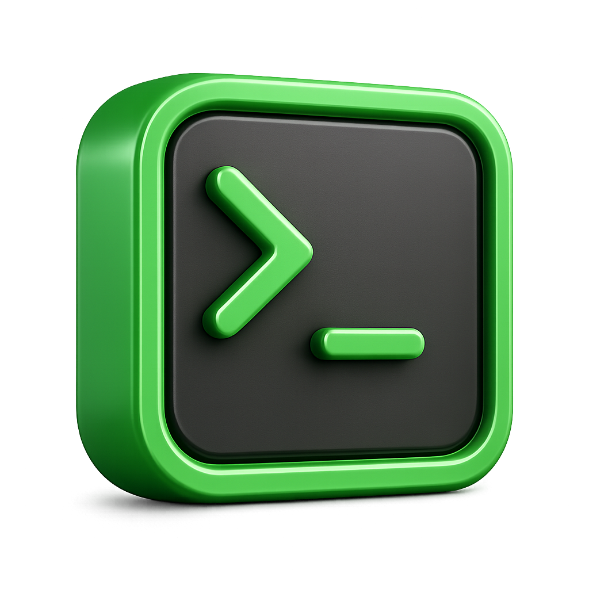

<p align="center">
  
</p>

<h1 align="center">⌘ Commander</h1>

<p align="center">
  <strong>Run Claude Code on a server, over HTTP — in any directory, with live streaming.</strong>
</p>

<p align="center">
  <a href="#run"></a>
  
  
  <a href="LICENSE"></a>
</p>

---

Commander is an HTTP API (v1) that runs **Claude Code** on your server in **any
directory you choose**. Send it commands, watch the output **live** over
Server-Sent Events, read the final report, or drive a **persistent interactive
Claude terminal**. It ships with a web dashboard, **Swagger docs**, and
**token auth shown as a QR code in the terminal** so you can connect from your
phone in seconds.

## Features

- **Run anywhere** — every request specifies the working `path`; Claude runs there.
- **Live reports** — stream Claude's output token-by-token over SSE while it works.
- **Final report** — fetch the assembled assistant text and result afterwards.
- **Stateful sessions** — keep conversation context across commands, like the REPL.
- **Interactive terminals** — turn an interactive `claude` process **on/off** in a
  PTY at a path, then pass it commands/keystrokes and watch the live screen. Every
  slash command works natively here — type `/model`, `/clear`, anything — Claude
  handles it. **No API key required.**
- **Free terminals & exec** — open a plain shell (or any command) in a PTY and drive
  it live, or run a single command one-off and capture its `stdout`/`stderr`/exit code.
- **Swagger / OpenAPI** — interactive docs at `/docs`, schema at `/openapi.json`.
- **QR-code auth** — a token is generated on startup and printed as a scannable QR
  code plus copyable text. Send it as `X-API-Key` (or `?token=` for streams).

## Requirements

- Python 3.10+
- The `claude` CLI authenticated (`claude auth login`). **`run.sh` installs it
  automatically if missing** and adds it to your `~/.bashrc` PATH.

## Run

```bash
git clone https://github.com/<you>/commander.git
cd commander
./run.sh
```

`run.sh` will:
1. Ensure the `claude` CLI is installed (installs it and persists `~/.local/bin`
   to `~/.bashrc` if not found).
2. Create a virtualenv and install dependencies.
3. Start the server, printing a QR code + token:

```
────────────────────────────────────────────────────────────────
  ⌘  COMMANDER  —  Claude-on-server API
────────────────────────────────────────────────────────────────
  Scan to open the dashboard (token embedded):
        [ QR CODE ]
  Dashboard URL : http://<your-ip>:8787/?token=<token>
  API token     : <token>
  Header        : X-API-Key: <token>
```

Scan the QR with your phone (same network) to open the dashboard, copy the token
for API calls, or open `http://127.0.0.1:8787/` in a browser.

- **Dashboard:** http://127.0.0.1:8787/
- **Swagger UI:** http://127.0.0.1:8787/docs
- **OpenAPI schema:** http://127.0.0.1:8787/openapi.json

> Prefer to run it yourself? `pip install -e .` then `python -m commander` (or the
> installed `commander` script) does the same thing without the bootstrap script.

## Configuration (environment variables)

| Variable | Default | Purpose |
|---|---|---|
| `COMMANDER_HOST` | `0.0.0.0` | Bind address |
| `COMMANDER_PORT` | `8787` | Port |
| `COMMANDER_API_KEY` | _(generated)_ | Fix the auth token instead of generating one |
| `COMMANDER_TOKEN_FILE` | `~/.commander/token` | Where the generated token is persisted |
| `COMMANDER_PERMISSION_MODE` | `acceptEdits` | Default permission mode (`default`, `acceptEdits`, `bypassPermissions`, `plan`) |
| `COMMANDER_MODEL` | _(unset)_ | Default model |
| `COMMANDER_ALLOWED_ROOTS` | _(any)_ | Comma-separated path prefixes tasks may run in |
| `COMMANDER_MAX_EVENTS` | `5000` | Event lines retained per task in memory |
| `COMMANDER_CLAUDE_BIN` | `claude` | Path to the claude executable |

## API (v1)

All endpoints are under **`/v1`** and require the token via `X-API-Key: <token>`
(or `?token=` for SSE streams). `GET /health` is unversioned and open.

### Tasks — one-off runs

```bash
TOKEN=<your token>

# Start a task in a directory
curl -X POST 127.0.0.1:8787/v1/tasks \
  -H "X-API-Key: $TOKEN" -H "Content-Type: application/json" \
  -d '{"prompt":"Run the tests and summarize failures","path":"/srv/myapp"}'
# -> { "id": "abc123", "status": "running", ... }

curl -N "127.0.0.1:8787/v1/tasks/abc123/stream?token=$TOKEN"   # watch live (SSE)
curl -H "X-API-Key: $TOKEN" 127.0.0.1:8787/v1/tasks/abc123     # status + report
curl -X POST -H "X-API-Key: $TOKEN" 127.0.0.1:8787/v1/tasks/abc123/stop
```

| Method | Path | Description |
|---|---|---|
| `POST` | `/v1/tasks` | Start a task (`prompt`, `path`, optional `model`, `permission_mode`, `session_id`) |
| `GET` | `/v1/tasks` | List tasks |
| `GET` | `/v1/tasks/{id}` | Detail + assembled report |
| `GET` | `/v1/tasks/{id}/events` | Raw buffered events |
| `GET` | `/v1/tasks/{id}/stream` | Live SSE stream |
| `POST` | `/v1/tasks/{id}/stop` | Stop a running task |

### Sessions — stateful, like the REPL

```bash
SID=$(curl -s -X POST 127.0.0.1:8787/v1/sessions \
  -H "X-API-Key: $TOKEN" -H "Content-Type: application/json" \
  -d '{"path":"/srv/myapp"}' | jq -r .id)

curl ... -d '{"command":"/model opus"}'   # switch model by name
curl ... -d '{"command":"Add a /health endpoint and a test"}'   # runs, keeps context
curl ... -d '{"command":"/clear"}'        # new session (drop context)
# (POST each to /v1/sessions/$SID/commands)
```

| Method | Path | Description |
|---|---|---|
| `POST` | `/v1/sessions` | Create a session (`path`, optional `model`, `permission_mode`) |
| `GET` | `/v1/sessions` | List sessions |
| `GET` | `/v1/sessions/{id}` | Session detail |
| `POST` | `/v1/sessions/{id}/commands` | Send a command or slash command |

Slash commands: `/model <id>` (switch), `/clear` (new session), `/help`. For the
interactive model picker with the live list, type `/model` in a **terminal**.

### Auth — is Claude logged in?

The startup banner shows login status. You can also check it via the API, and
any task that fails because Claude isn't authenticated returns `needs_login: true`
with a hint to run `claude auth login`.

```bash
curl -H "X-API-Key: $TOKEN" 127.0.0.1:8787/v1/auth/status
# logged in:  {"loggedIn": true, "authMethod": "claude.ai", "email": "...", ...}
# logged out: {"loggedIn": false, "hint": "Claude is not logged in ... run `claude auth login` ..."}
```

| Method | Path | Description |
|---|---|---|
| `GET` | `/v1/auth/status` | Claude login status (+ `hint` when logged out) |

> **Just `claude auth login` is enough.** A Pro/Max subscription login authenticates
> Claude for everything Commander does — tasks, sessions, and terminals. No API key
> is ever required: to switch models, type `/model` in a terminal and use Claude's
> own picker, or set one by name with `/model <id>`.

### Terminals — persistent interactive Claude (on/off)

Launches the interactive `claude` TUI in a PTY at a path and keeps it alive.
First-run trust/bypass dialogs are auto-accepted; then you pass it commands.

```bash
# Turn ON
TID=$(curl -s -X POST 127.0.0.1:8787/v1/terminals \
  -H "X-API-Key: $TOKEN" -H "Content-Type: application/json" \
  -d '{"path":"/srv/myapp"}' | jq -r .id)

# Watch the live screen (SSE; each event is {"chunk": "<raw terminal output>"})
curl -N "127.0.0.1:8787/v1/terminals/$TID/stream?token=$TOKEN"

# Pass a command (submit=true appends Enter). Wait until the REPL is ready
# (watch the stream for the prompt) before sending the first command.
curl ... -d '{"data":"Refactor utils.py and run the tests","submit":true}'   # -> /input

# Send raw keystrokes too (e.g. Esc to interrupt, arrows to navigate)
curl ... -d '{"data":"","submit":false}'   # Esc

curl -X POST ... /v1/terminals/$TID/off   # turn OFF
curl -X POST ... /v1/terminals/$TID/on    # turn back ON
```

| Method | Path | Description |
|---|---|---|
| `POST` | `/v1/terminals` | Turn ON (`path`, optional `model`, `permission_mode`, `skip_permissions`, `auto_accept`) |
| `GET` | `/v1/terminals` | List terminals |
| `GET` | `/v1/terminals/{id}` | Detail + current screen `snapshot` |
| `POST` | `/v1/terminals/{id}/on` | Turn ON / restart |
| `POST` | `/v1/terminals/{id}/off` | Turn OFF |
| `POST` | `/v1/terminals/{id}/input` | Send command/keystrokes (`data`, `submit`) |
| `GET` | `/v1/terminals/{id}/stream` | Live terminal output (SSE) |
| `DELETE` | `/v1/terminals/{id}` | Turn off and remove |

> The terminal output is raw ANSI from the TUI. Render it with a terminal
> emulator (e.g. xterm.js) for a faithful view, or read the plain `snapshot`.

### Shells — free terminals & one-off exec

A **shell** is the same PTY machinery as a terminal, but it launches any command
(the server's `$SHELL` by default) instead of `claude` — so you can run arbitrary
commands on the server. For a quick one-off, `POST /v1/exec` runs a single command
and returns its captured output.

```bash
# One-off: run a command and get stdout/stderr/exit_code back
curl -X POST 127.0.0.1:8787/v1/exec \
  -H "X-API-Key: $TOKEN" -H 'Content-Type: application/json' \
  -d '{"command":"ls -la && git status","path":"/srv/app","timeout":60}'

# Interactive shell in a PTY
SID=$(curl -s -X POST 127.0.0.1:8787/v1/shells \
  -H "X-API-Key: $TOKEN" -H 'Content-Type: application/json' \
  -d '{"path":"/srv/app"}' | jq -r .id)
curl -X POST -H "X-API-Key: $TOKEN" -H 'Content-Type: application/json' \
  -d '{"data":"echo hello"}' 127.0.0.1:8787/v1/shells/$SID/input
curl -N "127.0.0.1:8787/v1/shells/$SID/stream?token=$TOKEN"   # watch live (SSE)
```

| Method | Path | Description |
|---|---|---|
| `POST` | `/v1/exec` | Run one command, capture output (`command`, `path`, optional `timeout`) |
| `POST` | `/v1/shells` | Open a free terminal (`path`, optional `command`, `rows`, `cols`) |
| `GET` | `/v1/shells` | List shells |
| `GET` | `/v1/shells/{id}` | Detail + current screen `snapshot` |
| `POST` | `/v1/shells/{id}/on` | Turn ON / restart |
| `POST` | `/v1/shells/{id}/off` | Turn OFF |
| `POST` | `/v1/shells/{id}/input` | Send command/keystrokes (`data`, `submit`) |
| `GET` | `/v1/shells/{id}/stream` | Live shell output (SSE) |
| `DELETE` | `/v1/shells/{id}` | Turn off and remove |

> ⚠️ A free shell runs commands with the server process's full privileges. Use
> `COMMANDER_API_KEY` and `COMMANDER_ALLOWED_ROOTS` to limit who can reach it and
> where commands may run.

## Project layout

```
commander/
├── __main__.py    # `python -m commander` — server entry point + QR banner
├── main.py        # FastAPI app, all /v1 routes
├── config.py      # Settings from environment variables
├── runner.py      # Tasks & stateful sessions (claude -p, SSE events)
├── terminal.py    # Persistent PTY terminals — interactive claude and free shells
├── account.py     # Claude login status
├── auth.py        # Token generation + QR-code banner
└── models.py      # Pydantic request/response schemas
static/index.html  # Web dashboard
run.sh             # Bootstrap: install claude, venv, launch
```

## Security notes

- Treat the token like a password; anyone with it can run Claude on your server.
- `bypassPermissions` / `skip_permissions` let Claude act without prompting — use deliberately.
- Set `COMMANDER_ALLOWED_ROOTS` to restrict which directories may be used.
- Bind to `127.0.0.1` and tunnel, or front with TLS, if exposing beyond 127.0.0.1.

## License

Released under the [MIT License](LICENSE).
